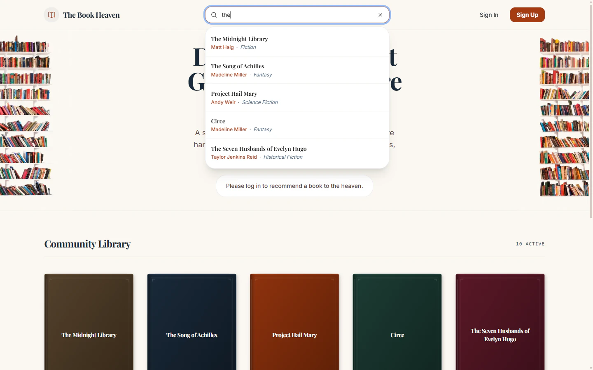
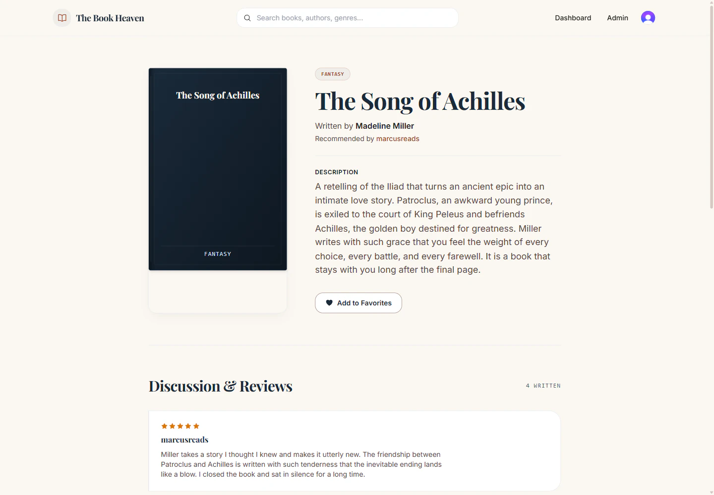
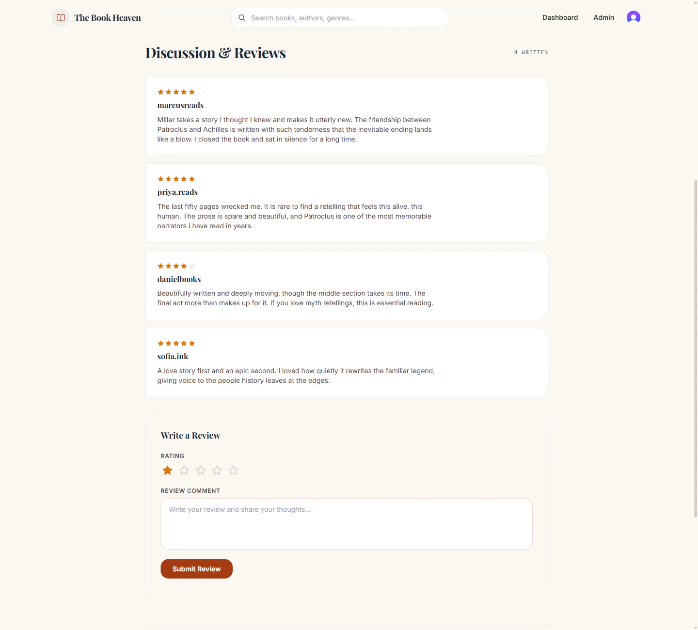
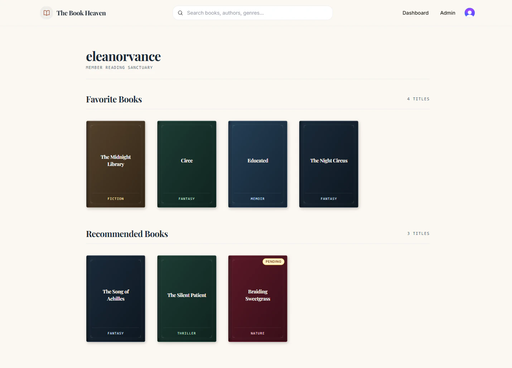
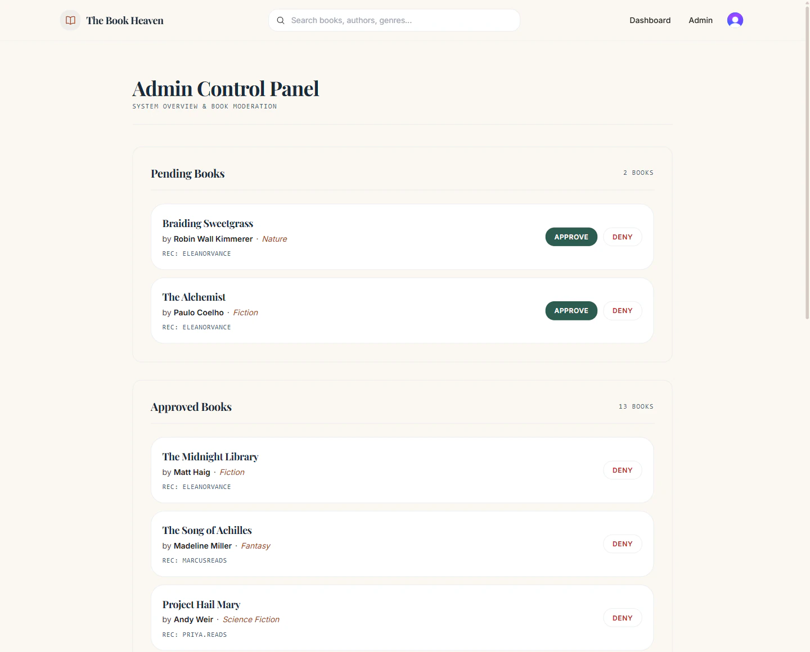

# The Book Heaven

## What is this?

**The Book Heaven is a community library where readers recommend their favorite books to each other.**

Ever finished a great book and wished you could tell the world about it? Or browsed a bookstore with no idea what to pick next? The Book Heaven fixes both: instead of a store you buy from, it is a place where people share the books they love — complete with a short note on why it is worth reading, a 1–5 star rating, and a public profile showing every book they have recommended.

Anyone can browse the growing collection and search for books by title, author, or genre. When a reader wants to add a book, they sign in, submit their recommendation, and it goes through a simple moderation queue — admins approve or deny submissions so the library only ever shows quality, real recommendations. There is also a "favorites" system so members can keep a personal list of books they want to read next.

In short: **a community-run, moderated space for sharing and discovering great reads.**

## How it works (in 30 seconds)

1. **Visitors** browse the "Community Library", search, read book details and reviews.
2. **Signed-in members** recommend books, rate and review approved titles, save favorites, and manage their recommendations from a personal dashboard.
3. **Admins** moderate submissions through a control panel — approving or denying books before they become visible to everyone.

## Screenshots

A quick tour of the app: browse the Community Library, search for a title, dig into a book's details and reviews, manage your reading list, and moderate submissions.


<p align="center">
  
  
</p>

<p align="center">
  
  
</p>



*Screenshots show the app running with sample library content.*

## Frontend & Backend

- A web app (frontend) built with Next.js
- A REST API (backend) built with Express and MongoDB

| Folder | Role | Stack |
| --- | --- | --- |
| [`the-book-heaven-frontend`](https://github.com/zakriayousafzai/the-book-heaven-frontend) | Web client | Next.js (App Router), React 19, Tailwind CSS, Clerk, Zustand |
| [`the-book-heaven-backend`](https://github.com/zakriayousafzai/the-book-heaven-backend) | REST API | Node.js, Express, MongoDB (Mongoose), Clerk Express |

---

## Features

- **Community Library** – Browse all books with a responsive grid of generated book covers.
- **Recommend a Book** – Signed-in readers can submit a recommendation (title, author, genre, description).
- **Moderation workflow** – Submitted books land in `pending` and are approved or denied by admins before becoming publicly visible.
- **Live search** – Debounced, keyboard-navigable search across title, author, genre, and description.
- **Book details** – Cover, metadata, recommender link, description, favorite toggle, edit and delete (owner or admin).
- **Reviews & ratings** – 1–5 star ratings with editable comments; verified after a book is approved.
- **Related books** – Books sharing the same genre shown on the details page.
- **Favorites** – Authenticated users can favorite books and manage them from their dashboard.
- **Public profiles** – `user/[username]` pages show a reader's approved recommendations; owners also see their favorites and pending books.
- **Dashboard** – Personal view (favorites + recommendations) for the signed-in user.
- **Admin panel** – Dedicated drawer listing Pending / Approved / Denied books with approve/deny actions.
- **Auth & roles** – Clerk-powered sign-in/sign-up; `admin` role gates the admin panel and moderation API.

---

## Tech Stack

### Frontend

- **Next.js 16** with the App Router (Server Components by default, `"use client"` where interactive)
- **React 19**
- **Tailwind CSS 3** with a zinc & bronze (amber) dark theme via CSS variables
- **Clerk (`@clerk/nextjs`)** for authentication and role metadata
- **Zustand** for global client state (books + favorites stores)
- **framer-motion** for animations/micro-interactions
- **Heroicons** for icons, **axios** for HTTP

### Backend

- **Node.js + Express 4**
- **MongoDB with Mongoose 8** (ODM, schemas, population)
- **Clerk (`@clerk/express`)** for auth middleware and user lookup
- **cors** and **dotenv**

---

## Project Structure

```
the-book-heaven/
├── the-book-heaven-frontend/          # Next.js web client
│   ├── app/
│   │   ├── layout.js                  # Root layout: ClerkProvider, Navbar, fonts, metadata
│   │   ├── page.js                    # Home — Community Library (BookList)
│   │   ├── globals.css                # Theme tokens, reset, scrollbars
│   │   ├── admin/                     # Admin control panel
│   │   │   ├── page.js               # Server guard: redirects non-admins
│   │   │   └── Components/
│   │   │       ├── AdminDashboard.js # Pending / Approved / Denied sections
│   │   │       └── BookSection.js    # Status-filtered list + approve/deny actions
│   │   ├── bookDetailsPage/[id]/     # Book details page
│   │   │   ├── page.js
│   │   │   └── components/
│   │   │       ├── BookDetails.js        # Cover, metadata, favorite/edit/delete
│   │   │       ├── ReviewSection.js      # List + submit reviews (star rating)
│   │   │       ├── ReviewCard.js         # Single review w/ edit & delete
│   │   │       ├── StarRating.js         # Read-only stars
│   │   │       ├── EditableStarRating.js # Interactive stars
│   │   │       └── RelatedBooks.js       # Same-genre recommendations
│   │   ├── components/
│   │   │   ├── Navbar.js             # Logo, search, auth buttons, dashboard/admin links
│   │   │   ├── SearchBar.js          # Debounced live search dropdown
│   │   │   ├── BookList.js           # Home hero + catalog + pagination
│   │   │   ├── BookGrid.js           # Responsive book card grid
│   │   │   ├── BookCard.js           # Generated "book cover" card
│   │   │   ├── BookForm.js           # Add/Edit recommendation modal
│   │   │   ├── BookLoading.js        # Skeleton grid + page-flip loader
│   │   │   ├── Modal.js              # Reusable modal (escape/backdrop close)
│   │   │   ├── Pagination.js         # Page numbers + prev/next
│   │   │   ├── ErrorBoundary.js      # Crash fallback with retry
│   │   │   └── StoreInitializer.js   # Hydrates books + favorites stores
│   │   ├── dashboard/              # Signed-in user dashboard
│   │   │   ├── page.js
│   │   │   └── Components/FetchData.js  # Favorites + Recommended sections
│   │   ├── store/
│   │   │   ├── useBooksStore.js      # Books list, pagination, fetch/search state
│   │   │   └── useFavoriteStore.js   # User favorites
│   │   └── user/[username]/          # Public profile page
│   │       ├── page.js
│   │       └── Components/FetchData.js  # Recommended books (owner-aware)
│   ├── docs/screenshots/             # Images used in this README
│   ├── proxy.js                      # Clerk middleware matcher
│   ├── next.config.mjs
│   ├── tailwind.config.mjs           # Theme colors + BG gradients
│   ├── jsconfig.json                 # "@/" path alias
│   ├── package.json
│   └── .env                          # Clerk keys + NEXT_PUBLIC_API_URL
│
└── the-book-heaven-backend/          # Express REST API
    ├── server.js                     # App wiring, CORS, Clerk, routes
    ├── config/
    │   ├── env.js                    # Loads PORT/DB_URI from .env
    │   └── db.js                     # Mongoose connection
    ├── models/
    │   ├── Book.js                   # Book schema w/ moderation status
    │   ├── Review.js                 # Review schema (1–5 rating)
    │   └── profile.model.js          # Profile: recommendations + favorites
    ├── routes/
    │   ├── bookRoutes.js             # Books CRUD
    │   ├── reviewRoutes.js           # Reviews per book
    │   ├── search.router.js          # Search across books
    │   ├── favorites.router.js      # Favorites API
    │   ├── profile.router.js        # Public profile by username
    │   └── admin.router.js          # Admin moderation
    ├── controllers/
    │   ├── search.controller.js
    │   ├── profile.controller.js    # Favorites + profile lookups
    │   └── admin.controller.js      # Pending list, approve, deny
    ├── middleware/
    │   ├── auth.middleware.js       # requireAuth, requireAdmin, getClerkIdentity
    │   └── error.middleware.js      # Mongoose/Express error normalization
    ├── package.json
    └── .env                           # PORT, DB_URI, Clerk keys
```

---

## Architecture

```
Browser (Next.js client)
   │  axios (REST, Bearer token from Clerk)
   ▼
Express API  (PORT 5000, /api/...)
   │  @clerk/express (verify JWT/session)
   ▼
MongoDB  (Mongoose, connection in config/db.js)
```

- The **frontend** communicates with the backend through `NEXT_PUBLIC_API_URL` (e.g. `http://localhost:5000`).
- **Clerk** provides authentication. The client signs in via Clerk and attaches a JWT (`Authorization: Bearer <token>`) from `getToken()`; the backend verifies it with `clerkMiddleware()` and helpers in `middleware/auth.middleware.js`.
- **Roles** are read from Clerk user metadata (`metadata.role === "admin"`). Admins can access `/admin/*` routes and the moderation endpoints.
- **Moderation**: books created by non-admins start with `status: "pending"`. Only `allowed` books appear in the public catalog, search, related books, and public profiles.

### User flows

1. **Visitor** – browses the catalog, searches, reads book details and reviews, visits public profiles.
2. **Signed-in user** – additionally recommends books (enters moderation), favorites books, reviews approved books, edits/deletes own content, accesses `/dashboard`.
3. **Admin** – sees/admin the admin panel, approves or denies pending books, and can delete/modify any content.

---

## Data Models

### Book (`models/Book.js`)
| Field | Type | Notes |
| --- | --- | --- |
| `userId` | String | Clerk user id of the recommender |
| `userName` | String | Recommender's Clerk username |
| `title` | String | required |
| `author` | String | required |
| `genre` | String | required |
| `description` | String | required |
| `status` | String | `allowed` \| `pending` \| `denied` (default `pending`) |

### Review (`models/Review.js`)
| Field | Type | Notes |
| --- | --- | --- |
| `bookId` | ObjectId → Book | required |
| `userId` | String | Review author (Clerk id) |
| `reviewerName` | String | Display name |
| `rating` | Number | 1–5 |
| `comment` | String | required |

### Profile (`models/profile.model.js`)
| Field | Type | Notes |
| --- | --- | --- |
| `userId` | String | unique |
| `username` | String | unique |
| `recommendedBooks` | [ObjectId → Book] | Books the user recommended |
| `favoriteBooks` | [ObjectId → Book] | Books the user favorited |

---

## API Reference

Base URL: `http://localhost:5000/api`. All routes run behind `clerkMiddleware()`; protected routes also require `Authorization: Bearer <token>`.

| Method | Endpoint                        | Auth          | Description |
| --- | --- | --- | --- |
| GET | `/books?page=&limit=` | Public | Paginated list of `allowed` books |
| GET | `/books/:id` | Public | Single book by id |
| POST | `/books` | User | Create book recommendation (goes to `pending` unless admin) |
| PUT | `/books/:id` | User | Update a book |
| DELETE | `/books/:id` | User / Admin | Delete a book (+ cascades reviews, updates profile) |
| GET | `/books/search?q=` | Public | Full-text regex search (allowed books) |
| GET | `/books/:id/reviews?page=&limit=` | Public | Paginated reviews for a book |
| POST | `/books/:id/reviews` | User | Add a review (only if book `allowed`) |
| PUT | `/reviews/:id` | User | Update a review |
| DELETE | `/reviews/:id` | User / Admin | Delete a review |
| GET | `/favorite` | User | Get favorites (populated) |
| POST | `/favorite` | User | Add favorite |
| DELETE | `/favorite/:bookId` | User | Remove favorite |
| GET | `/users/:username` | Public / Owner | Public profile (owner sees pending + favorites) |
| GET | `/admin/books?status=` | Admin | List books by moderation status (default `pending`) |
| POST | `/admin/books/:bookId/approve` | Admin | Mark book `allowed` |
| POST | `/admin/books/:bookId/deny` | Admin | Mark book `denied` |

---

## Getting Started

### Prerequisites

- Node.js (the frontend targets Next.js 16 / React 19)
- npm
- MongoDB (connection URI, e.g. a Mongo Atlas cluster)
- A [Clerk](https://clerk.com) application (publishable + secret keys)

### 1. Backend

```bash
cd the-book-heaven-backend
npm install
cp .env.example .env   # or create .env manually (see below)
npm start              # runs node server.js on PORT 5000
```

Required `.env` values:

```
PORT=5000
DB_URI=<your mongo connection string>
CLERK_PUBLISHABLE_KEY=<clerk publishable key>
CLERK_SECRET_KEY=<clerk secret key>
```

### 2. Frontend

```bash
cd the-book-heaven-frontend
npm install
npm run dev            # Next.js dev server (default http://localhost:3000)
```

Required `.env` values:

```
NEXT_PUBLIC_CLERK_PUBLISHABLE_KEY=<clerk publishable key>
CLERK_SECRET_KEY=<clerk secret key>
NEXT_PUBLIC_API_URL=http://localhost:5000
```

### 3. Giving a user the `admin` role

In the Clerk dashboard, add `role: "admin"` to the user's public metadata (or session claims). The admin panel (`/admin`) and moderation API routes will then be accessible to that user.

---

## Scripts

| Folder | Command | Description |
| --- | --- | --- |
| frontend | `npm run dev` | Start Next.js in development |
| frontend | `npm run build` | Production build |
| frontend | `npm run start` | Start production server |
| frontend | `npm run lint` | Run ESLint (Next.js) |
| backend | `npm start` | Run the Express server (`node server.js`) |

Note: the backend declares `nodemon` as a dependency; you can run `npx nodemon server.js` for hot reload during development.

---

## Notes

- **Covers are generated** in CSS/Tailwind — each book renders a stylized cover with a deterministic palette derived from its id/title (no image uploads).
- The frontend bundles a design skill (`skill.md`) with guidance for building Tailwind-based UIs; it is a working aid, not part of the product runtime.
- The frontend `README.md` and backend `README.md` contain app-specific deep dives referenced from this file.